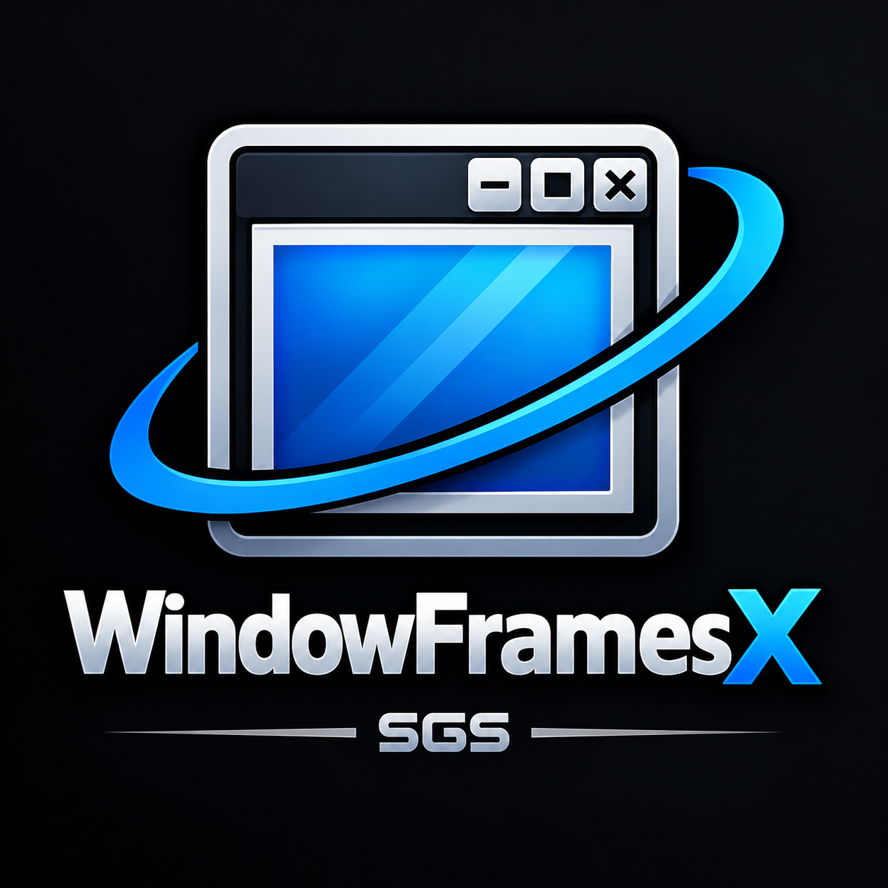
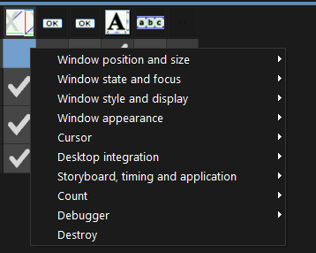
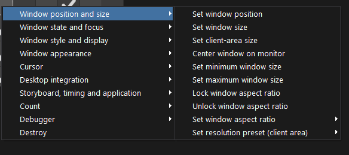
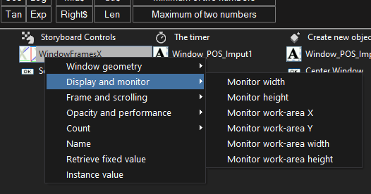
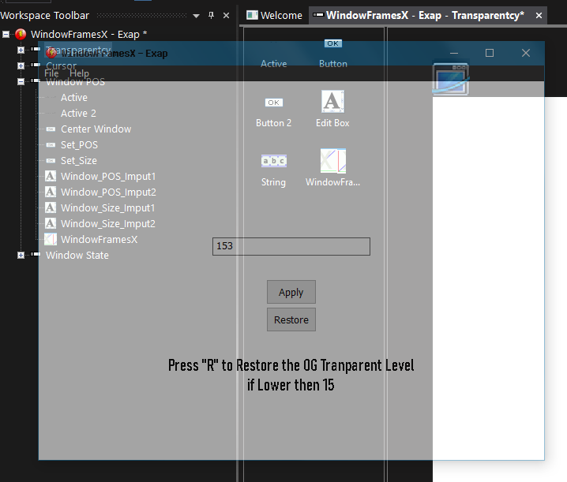
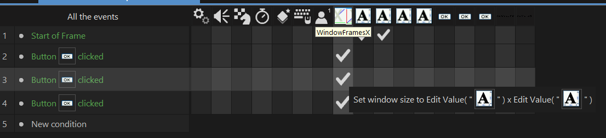
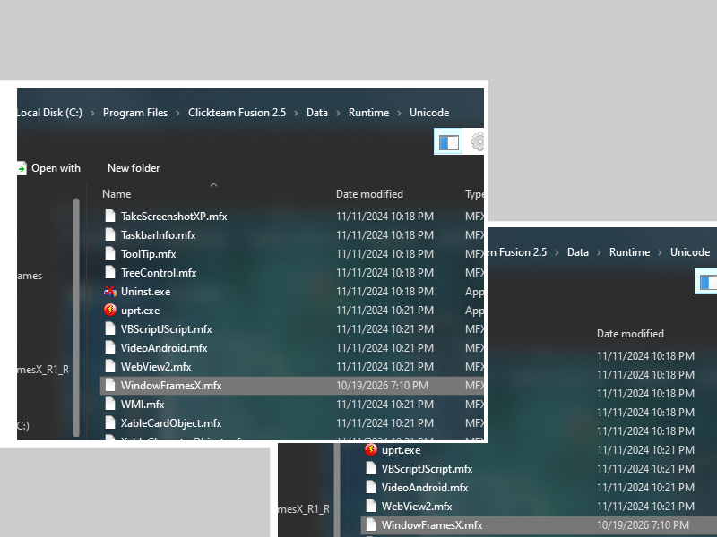
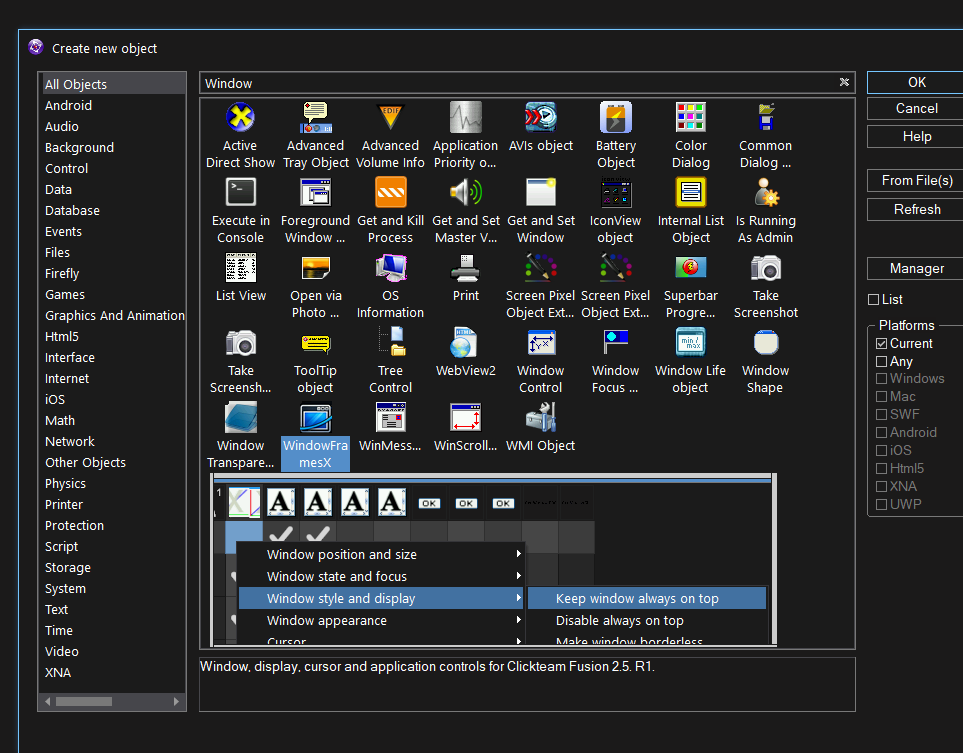
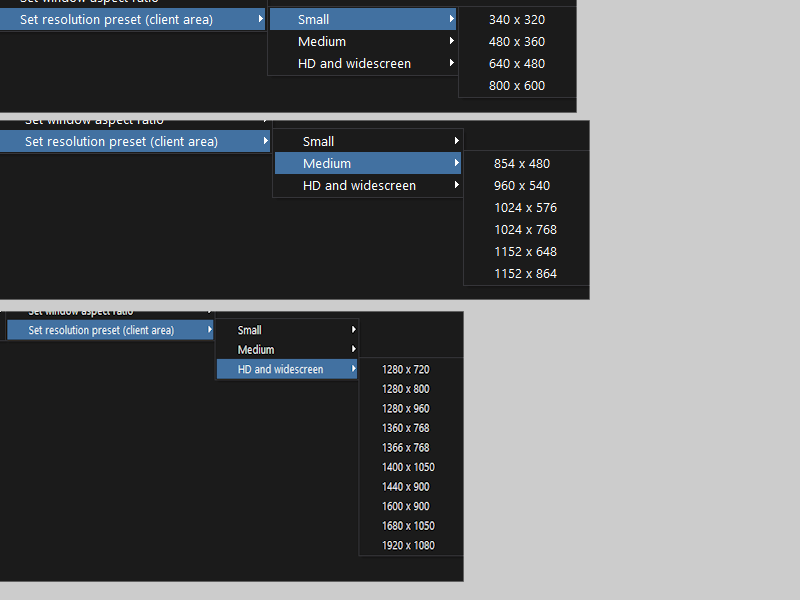

# WindowFramesX R1

**A native Windows extension for Clickteam Fusion 2.5** that gives your Fusion projects extra control over the application window, display behavior, timing, frame dimensions, and frame scrolling.

Developed by **SHAPELESS GOAT STUDIOS** — **Cyvix Zemran Voxless / sonic Fan Tech**. Created for *Portal: THE CLICKTEAM FUSION VERSION* and other SGS Clickteam Fusion projects.

> **Current release: R1**  
> R1 is the current completed feature set. Minor fixes and maintenance updates can remain R1; a substantial expansion of features is planned for a future R2 release.

Example image syntax: 

## Contents

- [Overview](#overview)
- [At a glance](#at-a-glance)
- [Screenshots](#screenshots)
- [Installation](#installation)
- [Using WindowFramesX](#using-windowframesx)
- [Actions](#actions)
- [Conditions](#conditions)
- [Expressions](#expressions)
- [Aspect-ratio presets](#aspect-ratio-presets)
- [Resolution presets](#resolution-presets)
- [Important behavior and compatibility notes](#important-behavior-and-compatibility-notes)
- [Not included in R1](#not-included-in-r1)
- [Building from source](#building-from-source)
- [Versioning](#versioning)
- [Credits and license](#credits-and-license)

## Overview

WindowFramesX is a non-visual, event-driven extension. Add it to a Fusion frame, then configure it from the Event Editor using actions, conditions, and expressions. It is intended to let developers build custom window options, resolution selectors, fullscreen toggles, window-state checks, simple camera/scroll controls, and other desktop-oriented behavior without writing a separate native program.

The extension's Event Editor entries are organized into nested menus to keep the lists manageable. Actions, conditions, and expressions are grouped by purpose rather than presented as one long flat list.

WindowFramesX works with the Windows version of Clickteam Fusion 2.5 and uses the classic Windows Fusion Extension SDK. It does not use CMake.

## At a glance

- Move, resize, center, minimize, maximize, restore, focus, and change the title of the application window.
- Read outer-window geometry separately from client/render-area dimensions.
- Change opacity and restore the original opacity.
- Toggle always-on-top, resizability, borderless styles, and borderless fullscreen.
- Save and restore window style, focus, opacity, and frame scroll position where supported by the corresponding action.
- Lock an aspect ratio manually or choose from 11 preset ratios, including ultrawide and portrait ratios.
- Select from 20 common client-area resolution presets, from **340 × 320** to **1920 × 1080**, or supply custom dimensions.
- Set minimum and maximum outer-window sizes.
- Hide/show the mouse cursor or clip/release it within the window.
- Attach the window to or detach it from the Windows desktop.
- Pause, resume, or end the application.
- Measure the extension's observed FPS and optionally apply a soft FPS cap.
- Set Fusion's configured frame rate separately from the WindowFramesX soft cap.
- Request VSync changes and switch between native fullscreen and windowed mode, subject to runtime/renderer support.
- Read monitor and work-area dimensions, frame dimensions, scroll position, window opacity, title, and other runtime values.
- Change frame dimensions/background color and set/save/restore frame scroll coordinates.

## Screenshots

Add your screenshots in `docs/images/` (or change the paths below to match wherever you store them). The commented image lines are placeholders; uncomment each line after adding the corresponding image file.

### WindowFramesX object and icon

> **Image placeholder:** Screenshot or crop showing the WindowFramesX object icon in Fusion. Suggested file: docs/images/windowframesx-icon.png
<!--  -->

### Event Editor action menus

> **Image placeholder:** Show the top-level action groups and nested action submenus. Suggested file: docs/images/event-editor-actions.png
<!--  -->

### Window position, size, aspect ratio, and resolution presets

> **Image placeholder:** Show the position/size submenu, aspect-ratio presets, and resolution preset categories. Suggested file: docs/images/window-size-presets.png
<!--  -->

### Conditions and expressions

> **Image placeholder:** Show condition and expression menus in Fusion. Suggested file: docs/images/conditions-and-expressions.png
<!--  -->

### Example application window

> **Image placeholder:** Add a screenshot of a test application demonstrating a WindowFramesX feature such as borderless fullscreen, opacity, or a custom resolution. Suggested file: docs/images/runtime-example.png
<!--  -->

### Example Event Editor setup

> **Image placeholder:** Add an example MFA event sheet or screenshot illustrating a resolution menu or fullscreen toggle. Suggested file: docs/images/example-events.png
<!--  -->

## Installation

WindowFramesX has two roles in a Fusion installation: the editor needs the extension so it can appear in the object and Event Editor lists, and the built application needs the matching runtime extension.

1. Obtain the WindowFramesX R1 extension files.
2. Copy the editor-capable `WindowFramesX.mfx` to your Clickteam Fusion installation's `Extensions/Unicode/` folder.
3. Copy the matching runtime `WindowFramesX.mfx` to `Data/Runtime/Unicode/` when preparing or testing a runtime/standalone build. Use matching outputs from the same build configuration; do not mix editor and runtime binaries from different versions.
4. Restart Clickteam Fusion if the extension was installed while the editor was open.
5. Open a frame, insert the WindowFramesX object, and use its actions, conditions, and expressions in the Event Editor.

The exact Fusion installation path depends on where Fusion was installed. For example, the folders are typically beneath the Clickteam Fusion 2.5 installation directory.

> **Image placeholder:** Add a screenshot showing both the editor Extensions/Unicode folder and the Data/Runtime/Unicode folder. Suggested file: docs/images/installation-folders.png
<!--  -->

## Using WindowFramesX

WindowFramesX is configured through Fusion's **Event Editor**. Most functionality does not require setting object properties: place the object in the frame, add an event, and select the relevant WindowFramesX action or expression.

In the Event Editor, right-click to add a WindowFramesX action, condition, or expression, then browse the nested groups described below. Enter dimensions and coordinates as numbers or Fusion expressions. Text fields, such as the window title, accept string expressions.

**Useful distinction:** the *outer window size* includes the title bar and borders; the *client-area size* is the inside area used by the application. Resolution presets target the client area. The custom `Set window size` action instead targets the outer window dimensions.

> **Image placeholder:** Add a short screenshot sequence showing how to insert the object and choose an action. Suggested file: docs/images/getting-started-event.png
<!--  -->

## Actions

The following is the R1 action inventory, grouped to match the extension's Event Editor menus.

### Window position and size

| Action | What it does |
|---|---|
| **Set window position** | Moves the application window to the supplied screen X and Y coordinates. |
| **Set window size** | Sets the outer window width and height, including non-client borders. |
| **Set client-area size** | Sets the inside/client dimensions separately from the outer window. |
| **Center window on monitor** | Centers the application window on its current/nearest monitor. |
| **Set minimum window size** | Sets minimum outer-window width and height. A value of `0` disables that dimension's limit. |
| **Set maximum window size** | Sets maximum outer-window width and height. A value of `0` disables that dimension's limit. |
| **Lock window aspect ratio** | Applies a custom ratio using a width and height pair. |
| **Unlock window aspect ratio** | Removes the custom aspect-ratio lock. |
| **Set window aspect ratio** submenu | Applies one of the 11 preset ratios listed in [Aspect-ratio presets](#aspect-ratio-presets). The preset actions resize the window and enable the ratio lock. |
| **Set resolution preset (client area)** submenu | Selects one of the 20 client-area sizes listed in [Resolution presets](#resolution-presets). |

### Window state and focus

| Action | What it does |
|---|---|
| **Minimize window** | Minimizes the application window. |
| **Maximize window** | Maximizes the application window. |
| **Restore window** | Restores the window from minimized or maximized state. |
| **Set window focus** | Requests focus for the application window. Windows may restrict foreground activation in some circumstances. |
| **Save current focus** | Stores the currently focused window handle for later restoration. |
| **Restore saved focus** | Requests focus for the window handle saved by the previous action. |
| **Flash window in taskbar** | Requests a taskbar flash/attention indication for the application window. |

### Window style and display

| Action | What it does |
|---|---|
| **Keep window always on top** | Places the application window in the always-on-top Z-order. |
| **Disable always on top** | Removes the always-on-top setting. |
| **Make window borderless** | Removes the usual window border/title-bar style. |
| **Restore original window style** | Restores the window style captured when the WindowFramesX runtime object was created. |
| **Enter borderless fullscreen** | Expands the window into borderless fullscreen behavior and stores the state needed to return to windowed mode. |
| **Exit borderless fullscreen** | Leaves borderless fullscreen and restores the saved windowed geometry/style. |
| **Enable window resizing** | Makes the window resizable. |
| **Disable window resizing** | Prevents ordinary user resizing of the window. |

### Window appearance

| Action | What it does |
|---|---|
| **Set window title** | Changes the application window's title-bar text. |
| **Set window opacity** | Applies an opacity value from `0` to `255`: `0` is fully transparent and `255` is fully opaque. |
| **Restore original window opacity** | Restores the opacity state captured before WindowFramesX changed it. |
| **Set window background color** | Sets the color used by WindowFramesX for the application window's background handling. The input is a Windows `COLORREF`-style RGB value. |

### Cursor

| Action | What it does |
|---|---|
| **Clip cursor to window** | Restricts the Windows cursor to the application window's client rectangle. |
| **Release cursor clipping** | Removes the cursor clipping rectangle. |
| **Hide cursor** | Hides the Windows cursor while the extension's hide state is active. |
| **Show cursor** | Requests that the cursor be shown again. |

### Desktop integration

| Action | What it does |
|---|---|
| **Attach window to desktop** | Reparents the application window to the Windows desktop. This is an advanced operation and can change normal window behavior. |
| **Detach window from desktop** | Restores the saved parent/style/geometry associated with the desktop attachment operation. |

### Storyboard, timing and application → Application controls

| Action | What it does |
|---|---|
| **Set target FPS soft cap** | Requests a maximum loop rate from WindowFramesX by waiting between frames when necessary. `0` disables the soft cap; the action's input is capped at 240 FPS. This is not a way to make a slow application run faster. |
| **Pause application** | Requests that the current Fusion application pause. |
| **Resume application** | Resumes the application after it has been paused. |
| **End application** | Ends the running application. Use carefully; this is not a frame restart. |

### Storyboard, timing and application → Screen and VSync

| Action | What it does |
|---|---|
| **Set Fusion frame rate** | Changes Fusion's configured application/frame rate. The action accepts a separate FPS value (documented input range: 1–1000). This is different from WindowFramesX's own soft cap. |
| **Switch to native fullscreen mode** | Requests Fusion's native fullscreen/display mode rather than simply removing the window border. Availability depends on the renderer and display/runtime configuration. |
| **Return to windowed mode** | Requests restoration of windowed display mode after native fullscreen. |
| **Enable VSync** | Requests that the active Fusion surface enable vertical synchronization. |
| **Disable VSync** | Requests that the active Fusion surface disable vertical synchronization. |

### Storyboard, timing and application → Frame and scrolling

| Action | What it does |
|---|---|
| **Set frame dimensions** | Changes the current frame's width and height through the exposed Fusion runtime frame data. |
| **Set frame background color** | Changes the current frame's background color. The input is a Windows `COLORREF`-style RGB value. |
| **Set frame scroll position** | Sets the current frame's horizontal and vertical scroll coordinates. |
| **Save current scroll position** | Saves the current frame scroll coordinates in the WindowFramesX object instance. |
| **Restore saved scroll position** | Returns the frame to the scroll coordinates previously saved by that instance. |

## Conditions

R1 provides these conditions for checking the current window/runtime state in Fusion events.

| Condition | True when… |
|---|---|
| **Window has focus** | The application window has focus. |
| **Window is minimized** | The application window is minimized. |
| **Window is maximized** | The application window is maximized. |
| **Window is in borderless fullscreen** | WindowFramesX reports its borderless-fullscreen state as active. |
| **Window is visible** | The application window is visible. |
| **Cursor is clipped to the window** | WindowFramesX reports that cursor clipping is active. |
| **Window is attached to the desktop** | The desktop attachment action's state is active. |
| **Native fullscreen mode is active** | WindowFramesX reports that its native fullscreen request/state is active. |
| **VSync is enabled** | Fusion's relevant application/surface flag reports VSync as enabled. |

> **Image placeholder:** Add a screenshot of the Conditions menu. Suggested file: docs/images/conditions-menu.png
<!--  -->

## Expressions

Expressions let you read values from events, comparisons, counters, or text. Numeric expressions return numbers, except **`WindowTitle$`**, which returns a string.

### Window geometry

| Expression | Returns |
|---|---|
| **`WindowX()`** | The outer window's X coordinate on the desktop. |
| **`WindowY()`** | The outer window's Y coordinate on the desktop. |
| **`WindowWidth()`** | The outer window width, including borders/title bar. |
| **`WindowHeight()`** | The outer window height, including borders/title bar. |
| **`ClientWidth()`** | The application window's client-area width. |
| **`ClientHeight()`** | The application window's client-area height. |

### Display and monitor

| Expression | Returns |
|---|---|
| **`MonitorWidth()`** | Width of the monitor associated with the application window. |
| **`MonitorHeight()`** | Height of the monitor associated with the application window. |
| **`WorkAreaX()`** | X coordinate of that monitor's work area. |
| **`WorkAreaY()`** | Y coordinate of that monitor's work area. |
| **`WorkAreaWidth()`** | Width of that monitor's work area. |
| **`WorkAreaHeight()`** | Height of that monitor's work area. |

The monitor work area usually excludes reserved desktop areas such as the taskbar. Work-area coordinates are desktop/screen coordinates, not coordinates local to the Fusion frame.

### Opacity and performance

| Expression | Returns |
|---|---|
| **`WindowOpacity()`** | Current window opacity from `0` to `255`, where `255` is opaque. |
| **`MeasuredFPS()`** | WindowFramesX's measured loop rate. It is updated over a short measurement interval, so it is an estimate rather than a frame-perfect timing instrument. |
| **`TargetFPS()`** | The target FPS soft-cap value configured through WindowFramesX. `0` means disabled. |
| **`FusionFrameRate()`** | Fusion's configured frame-rate value, distinct from the WindowFramesX soft cap. |
| **`WindowBackgroundColor()`** | The background color value configured for WindowFramesX's window background handling. |
| **`WindowTitle$()`** | The current application window title as a string. |

### Frame and scrolling

| Expression | Returns |
|---|---|
| **`FrameWidth()`** | The current frame width reported by the runtime frame data. |
| **`FrameHeight()`** | The current frame height reported by the runtime frame data. |
| **`ScrollX()`** | The current frame's horizontal scroll coordinate. |
| **`ScrollY()`** | The current frame's vertical scroll coordinate. |

> **Image placeholder:** Add a screenshot of the Expressions menu. Suggested file: docs/images/expressions-menu.png
<!--  -->

## Aspect-ratio presets

The **Set window aspect ratio** submenu contains 11 preset actions. Each preset resizes the current window and enables the corresponding aspect-ratio lock.

| Preset | Common description |
|---|---|
| `1:1` | Square |
| `4:3` | Standard |
| `5:4` | Traditional monitor ratio |
| `3:2` | 3:2 |
| `16:10` | Widescreen 16:10 |
| `16:9` | Widescreen |
| `18:9` | 2:1 wide format |
| `21:9` | Ultrawide |
| `32:9` | Super ultrawide |
| `3:4` | Portrait |
| `9:16` | Portrait widescreen |

Use **Lock window aspect ratio** for ratios that are not available as presets; use **Unlock window aspect ratio** to stop enforcing the ratio.

## Resolution presets

The **Set resolution preset (client area)** submenu contains 20 common client-area dimensions. These numbers target the inside/render area rather than the full outer window, so WindowFramesX accounts for the current window borders when applying a preset.

### Small

- `340 × 320`
- `480 × 360`
- `640 × 480`
- `800 × 600`

### Medium

- `854 × 480`
- `960 × 540`
- `1024 × 576`
- `1024 × 768`
- `1152 × 648`
- `1152 × 864`

### HD and widescreen

- `1280 × 720`
- `1280 × 800`
- `1280 × 960`
- `1360 × 768`
- `1366 × 768`
- `1400 × 1050`
- `1440 × 900`
- `1600 × 900`
- `1680 × 1050`
- `1920 × 1080`

For a size that is not listed, use **Set window size** to specify outer dimensions or **Set client-area size** to specify the client/render area.

> **Image placeholder:** Add a screenshot showing the Small, Medium, and HD and widescreen submenu categories. Suggested file: docs/images/resolution-preset-submenus.png
<!--  -->

## Important behavior and compatibility notes

- **Windows only:** WindowFramesX is a native Windows extension and uses Win32 window APIs and the classic Windows Fusion SDK.
- **Fusion version:** Developed for Clickteam Fusion 2.5 Developer+ R294.14. Other Fusion builds should be tested rather than assumed compatible.
- **Native fullscreen is not borderless fullscreen:** Native fullscreen uses Fusion's screen-mode support. Borderless fullscreen changes the ordinary window style/geometry. They are separate features and use separate conditions.
- **VSync support varies:** The active Fusion surface or renderer may not allow VSync to be changed dynamically. Check the result in the target application and display mode.
- **Frame/runtime operations:** Frame dimensions, frame background, and scroll controls use runtime data/interfaces available through the classic SDK. Validate these in every Fusion/runtime configuration you plan to ship.
- **FPS controls are separate:** `Set target FPS soft cap` is WindowFramesX's optional wait-based cap. `Set Fusion frame rate` changes Fusion's configured rate. Neither guarantees a requested FPS if the game cannot render at that rate.
- **Window size versus client size:** The outer window includes its title bar and borders. The client area does not. Use the matching action for the result you need.
- **Desktop attachment is advanced:** Attaching the window changes its Win32 parent relationship and can make it behave differently from an ordinary application window. Test carefully and make sure your events detach/restore it as required.
- **Cursor ownership:** Hiding or clipping a cursor affects the shared Windows cursor state. Ensure your application has paths that show/release it again, including pause screens and menus.
- **Object state is instance-local:** Saved focus, saved scroll position, and other extension-maintained state belong to the WindowFramesX runtime object instance.
- **Window manager restrictions:** Windows can restrict focus-stealing and foreground activation. Some requested window state changes may be affected by the operating system.

## Not included in R1

The following Storyboard-related features are **not implemented in R1** and should not be treated as available actions:

- Jump directly to a specified frame.
- Go to the next frame or previous frame.
- Restart the current frame or restart the whole application through a dedicated restart action.
- Save and load a complete frame/application state.
- Clear the screen or clear a selected zone as a Storyboard operation.
- Delete or manage generated backdrops through dedicated Storyboard actions.
- Automatic object-relative scrolling/camera tracking. R1 supports setting, saving, and restoring explicit scroll coordinates, but that is not the same as following an active object automatically.

These items require a reliable runtime entry point or further investigation before they can be added. They may be considered for a future major release; they are not advertised as R1 features.

## Versioning

- **R1:** The current released feature set.
- **R1 maintenance updates:** Bug fixes, compatibility updates, documentation improvements, and resource changes that do not significantly expand the feature set. The public build label remains R1.
- **R2:** Reserved for a substantial feature expansion or major capability change.

## Credits and license

**Developer:** SHAPELESS GOAT STUDIOS  
**Creator / project attribution:** Cyvix Zemran Voxless / sonic Fan Tech  
**Primary project:** *Portal: THE CLICKTEAM FUSION VERSION* and other SGS Clickteam Fusion 2.5 projects  
**Technology:** C++ and the classic Clickteam Fusion Extension SDK

This repository includes SDK components used to build the extension. Review the applicable SDK terms and add the chosen WindowFramesX license or EULA before redistributing the source or binaries. **Project license/EULA: [Add the selected license or EULA here.]**

---

*WindowFramesX R1 — native window, display, timing, and frame-scrolling controls for Clickteam Fusion 2.5.*
